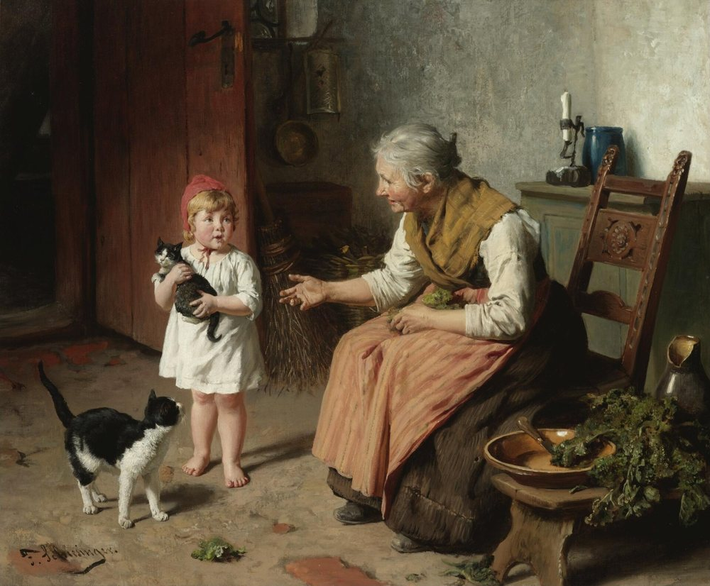

# El herbario de las sabias

Un vademécum de plantas medicinales con forma de libro de secretos: busca una
dolencia y te dice qué plantas se han usado tradicionalmente para aliviarla, cómo
se preparan y qué precauciones exigen. Ambientado en el saber de las mujeres a las
que llamaron brujas, que es de donde viene buena parte de esto.

**→ [Ver el sitio](https://topigra.github.io/herbario-de-las-sabias/)**



*Bei Großmutter*, de Felix Schlesinger. Dominio público.

## Qué hay dentro

| | |
|---|---|
| **55 plantas** | Una ficha por planta: parte usada, para qué sirve, preparación, dosis, precauciones y curiosidades. |
| **26 dolencias** | Todas documentadas, ninguna a medias. El índice dolencia → plantas se deriva solo de los datos. |
| **8 tisanas** | Mezclas de tres ingredientes, en el lateral. Al elegir una dolencia se marcan las que sirven. |
| **16 leyendas** | El folclore de la planta: qué se colgaba en la puerta, con qué se ataba la escoba, qué servía para echar la suerte. |
| **Entradas** | Artículos sobre el oficio, en `entradas/`. |

## Cómo está hecho

HTML, CSS y JavaScript a pelo. **Sin build, sin dependencias, sin CDN y sin
fuentes externas**: se abre con doble clic y funciona igual que servido por HTTP.

```
index.html      la portada: historia, índice de entradas, buscador y tisanario
estilo.css      la hoja de estilos, compartida con las entradas
entradas/       los artículos
fotos/          una foto por planta, de Wikimedia Commons
estampas/       los cuadros de la página, de dominio público
PROYECTO.md     cómo está construido y qué no hay que romper
```

Los datos viven en tres arrays dentro de `index.html` (`DOLENCIAS`, `PLANTAS`,
`TISANAS`). Añadir una planta a una dolencia es añadir un identificador a su lista
`indicaciones`: no hay ningún índice que mantener a mano.

## Esto no es consejo médico

Es divulgación sobre usos tradicionales. No sustituye el diagnóstico ni el
tratamiento de un profesional sanitario.

Dicho eso, el proyecto se toma esa parte en serio y tiene reglas que no se saltan:
cada ficha y cada tisana llevan sus contraindicaciones, sus interacciones con
medicamentos y el umbral a partir del cual hay que ir al médico; la ambientación se
queda en el diseño y en el folclore, y nunca entra en la preparación, la dosis ni
los avisos, que van en voz llana. Una tisana lleva además los riesgos que no tiene
ninguno de sus ingredientes por separado.

## Las imágenes

Todas de [Wikimedia Commons](https://commons.wikimedia.org), con su autoría y su
licencia verificadas una a una contra la API y recogidas en `fotos/creditos.json` y
`estampas/creditos.json`. El sitio las acredita en el pie, que para las licencias
Creative Commons no es cortesía sino obligación.

Dos cosas que conviene saber si reutilizas este código con otras imágenes:

- Cuando Commons no declara autor en el campo `Artist`, se atribuye a quien subió
  el archivo. «Autoría no indicada» no es un crédito válido para una CC BY-SA.
- Con la fotografía de un cuadro hay que mirar **dos** licencias: la de la obra y la
  de la fotografía.

## Licencia

El texto y el código son de su autor. Las imágenes van cada una con la suya, como
se detalla en los archivos de créditos: dominio público unas, Creative Commons
otras, y esas exigen mantener la atribución si las reutilizas.
